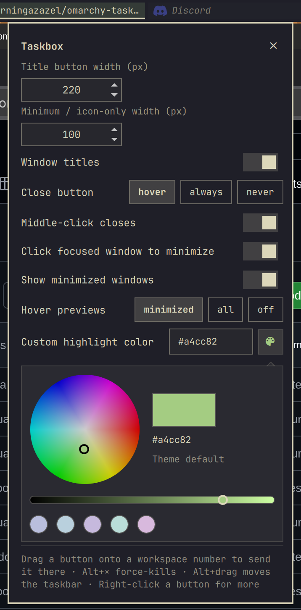

# Taskbox

A Windows-style taskbar for the [Omarchy](https://omarchy.org) bar: a button
for every window on the current workspace, with its icon, title and a close
button, plus minimize, drag-to-workspace and a right-click window menu.

**Omarchy 4.0+** · bar-widget plugin · MIT

<!-- screenshot to come:  -->

## Features

- **Fits the bar.** Buttons follow your theme and font and share the free
  space: they start at a default width, shrink as windows open, and extra
  windows go into a `+N` list. Any resolution, every monitor (each bar shows
  its own monitor's workspace).
- **Windows ordering.** Oldest window on the left, newest on the right; the
  taskbar hugs the right-hand widgets and grows toward the left.
- **Close or force kill** from the `×` (hold **Alt** to force kill).
- **Hover to find a window.** Its border lights up without stealing focus.
- **Drag to a workspace.** Drop a button on a workspace number to send the
  window there without following it.
- **Minimize and restore**, with minimized windows kept (dimmed) on the
  taskbar.
- **Right-click menu** and a built-in **settings popup**.
- **Vertical bars** get a column of icon-only buttons.
- **No setup.** The plugin loads its Hyprland side itself; your Hyprland
  config is never edited.

## Install

```bash
omarchy plugin add https://github.com/mourningazazel/omarchy-taskbox.git --enable
omarchy bar move mourningazazel.taskbox --section right --index 0
```

The second line puts it at the start of the right section, where it's designed
to sit. That's all.

- **Update:** `omarchy plugin update mourningazazel.taskbox`
- **Remove:** `omarchy plugin remove mourningazazel.taskbox`. Taskbox then
  has Hyprland reload its config once, which clears everything it added.

On an older Omarchy without Hyprland's Lua config, Taskbox still lists,
focuses and closes windows; the extras switch themselves off.

## Using it

| Action | Result |
|---|---|
| Click | Focus the window (your cursor stays where it is) |
| Click the focused window | Minimize it (can be turned off) |
| Click a minimized (dimmed) window | Restore it onto this workspace |
| Middle-click | Close the window |
| Hover | Light up that window's border, without focusing it |
| `×` | Close the window (the app may ask to save) |
| **Alt** + `×` | Force kill the app (the `×` turns red while Alt is held) |
| Right-click | Window menu: minimize/restore, maximize, float/tile, move to workspace, close, force kill, settings |
| Drag onto a workspace number | Send the window there without following it |
| **Alt** + drag | Move the whole taskbar elsewhere in the bar |

**Sending a window to another workspace** (drag, or *Move to workspace* in the
menu): you stay where you are and the window leaves quietly. It never arrives
fullscreen or maximized. It tiles in if that workspace has tiled windows,
floats if it only has floating ones, and anything maximized there is restored,
so nothing ends up hidden. The next time you open that workspace, the window
you sent is the focused one.

**Minimizing** parks the window on the special workspace `minimized`, the one
a hyprbars "minimize" button typically uses. Windows minimized by other tools
show up dimmed and restorable too (`minimized`: hyprbars, omadock;
`omarchy-minimized`: window-shelf, qol-desktop-plus). Taskbox remembers the
workspace each one came from on the window itself, so it survives restarts.

**Force kill** sends SIGKILL to the app's process, which closes all of that
app's windows without asking to save. Whether a click on `×` force-kills is
decided by Hyprland from the real state of the Alt key at that moment, so a
plain click never kills.

## Multiple monitors

Every monitor's bar has its own Taskbox, showing the windows on *that*
monitor's current workspace, sized to that bar (different resolutions and
fractional scaling are fine).

- Clicking a window on another monitor focuses it there; the cursor stays put.
- A minimized window stays on the taskbar of the monitor (workspace) it came
  from, and clicking it restores it there. A window that was never on a
  regular workspace (started minimized) shows on every taskbar.
- Hover highlights, menus and the `+N` list open on the monitor you're using;
  settings from the Omarchy menu open on the focused monitor.
- Unplugging a monitor just removes its taskbar; plugging it back brings it
  back. Nothing else is disturbed.
- Drag-to-workspace works with the workspaces widget on the same bar (a drag
  can't cross to another monitor's bar).

## Settings

<!-- screenshot to come:  -->

Right-click any button → **Taskbox settings…**, or run:

```bash
omarchy-shell shell toggle mourningazazel.taskbox
```

To add it to the Omarchy menu (Setup → Taskbox), add this line to
`~/.config/omarchy/extensions/omarchy-menu.jsonc`:

```jsonc
"setup.taskbox": {"icon":"󰖯","label":"Taskbox","aliases":["taskbar"],"action":"omarchy-shell shell toggle mourningazazel.taskbox '{}'"},
```

Settings live on the widget's entry in `~/.config/omarchy/shell.json`, and can
also be changed with `omarchy bar set mourningazazel.taskbox <key> <value> --json`
(drop `--json` for text values):

| Key | Default | |
|---|---|---|
| `maxWidth` | `200` | Default (widest) button width, px |
| `minWidth` | `44` | Buttons shrink to this before windows go into `+N` |
| `showTitle` | `true` | Show window titles (off = icons only) |
| `closeButton` | `"hover"` | When to show the `×`: `hover`, `always` or `never` |
| `middleClickClose` | `true` | Middle-click closes a window |
| `clickToMinimize` | `true` | Clicking the focused window minimizes it |
| `showMinimized` | `true` | Keep minimized windows on the taskbar (dimmed) |
| `minimizeWorkspace` | `"minimized"` | Special workspace minimized windows are parked on |

## Compatibility

- **Omarchy 4.0+.** Built for the restricted plugin API third-party widgets get
  from Omarchy 4.0.4 on, tested on 4.0.3 and in a 4.0.4-API emulation, and
  checked against Omarchy's development branch.
- **Hyprland 0.56** (Lua config), checked against the changes queued after it.

Works alongside (checked against their source):

| Plugins | How they fit together |
|---|---|
| Omarchy's workspaces widget and clones, decent-workspaces, saif/sofos/woogy7 workspaces, workspaces-jap, **per-monitor-workspaces** | Their numbers are drop targets. Taskbox sends to the real workspace behind a button, so per-monitor and named workspaces land where you'd expect. |
| hyprbars minimize, omadock, window-shelf, qol-desktop-plus | Windows they minimize show dimmed on Taskbox and restore from it. To have Taskbox minimize to the same place as window-shelf/qol-desktop-plus, set `minimizeWorkspace` to `omarchy-minimized`. |
| Alt+Tab switchers (altswitch, omalt-tab, omaswitch, alttab, macos.dock) | Both keep working: Hyprland runs every matching Alt bind, and Taskbox's never swallow Alt. |
| Replacement bars (Lacuna, Shibumi) | Taskbox runs in them; sizing and drag use the bar's own slots. |
| Trays and drawers that host other widgets (tyrichards.tray, plugin-drawer, pocket) | Taskbox can live inside them; it sizes itself naturally there. |
| Docks, overviews, notification and other widgets | Independent. |

## Known limitations

- **Omarchy updates.** Taskbox relies on some internals of Omarchy's bar. It
  checks for them at startup: if an update removes one, only the affected
  feature switches off, and the settings popup lists what's unavailable.
  Please open an issue with that list if it happens.
- An app's *own* minimize button (inside the window) isn't handled: Hyprland
  doesn't act on those requests without a native plugin.
- **Windows minimized before Taskbox was installed** don't have a remembered
  workspace yet, so they show on every workspace's taskbar until restored.
- **Drag targets** are the buttons of a workspaces widget on the same bar.
  The menu's *Move to workspace* lists 1–10 plus any other workspace that
  exists, by number.

## Troubleshooting

- **Something listed as unavailable in the settings popup:** see
  [Known limitations](#known-limitations); `omarchy restart shell` rules out
  a one-off load failure.
- **The right-click menu only has Close and settings, and drag/hover/Alt do nothing:** Taskbox
  couldn't load its Hyprland side. Check you're on Omarchy 4.0+, then run
  `omarchy restart shell`.
- **Alt+× closes normally instead of force-killing:** check the binds with
  `hyprctl binds | grep -A3 Alt_L`; if they're missing, `omarchy restart shell`.
- **Wrong or generic icon for an app:** run
  `omarchy-shell mourningazazel.taskbox icon <app id>` (the app id is in
  `omarchy-shell mourningazazel.taskbox state`) and include the output in an
  issue.
- **Anything else:** include the output of
  `omarchy-shell mourningazazel.taskbox state` and
  `journalctl --user -b | grep -iE 'taskbox|\.qml:'` in an issue.

## Contributing

Issues and pull requests are welcome. [AGENTS.md](AGENTS.md) documents the
architecture, the Omarchy internals Taskbox depends on, safety rules for
testing against a live Hyprland session, the test suites and a diagnosis
table (written for AI coding agents, useful for humans too).

```bash
tools/dev.sh test               # offline checks (also run by CI)
tools/dev.sh test live          # against your running desktop, using throwaway windows
tools/dev.sh test live --full   # + reload/restart/disable recovery, stress, left bar
```

## License

MIT, see [LICENSE](LICENSE).
