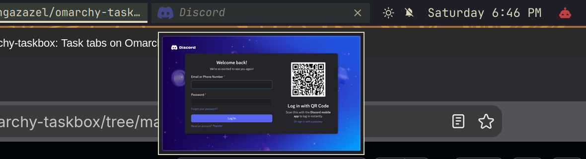
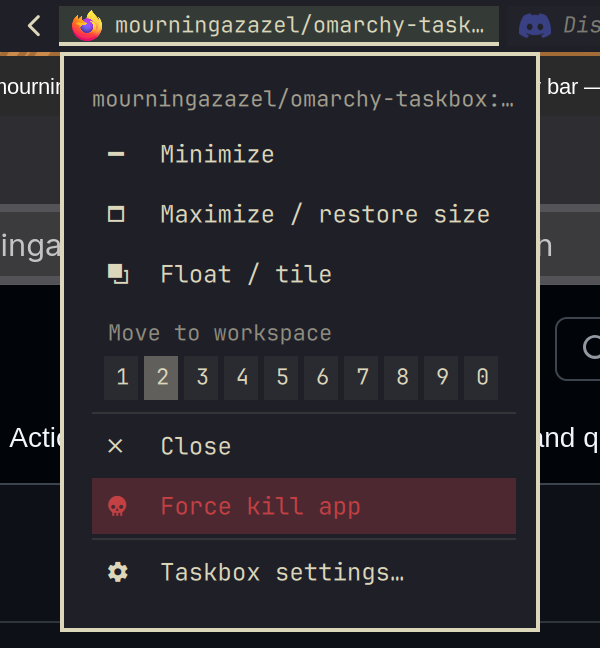

# Taskbox

Workspace-specific task tabs for the [Omarchy](https://omarchy.org) bar: a
button for every window on the current workspace, with its icon, title and a
close button.

Minimize and restore, drag a window to another workspace, peek at a
minimized window, and force-kill a stuck app — all from the bar.



## Install

```bash
omarchy plugin add https://github.com/mourningazazel/omarchy-taskbox.git --enable
omarchy bar move mourningazazel.taskbox --section right --index 0
```

The second line puts it at the start of the right section, where it's
designed to sit. Nothing else to set up.

## Requirements

- **Omarchy 4.0 or newer** (Hyprland 0.56+ with its Lua config).
- Tools it runs, all part of a standard Omarchy install: `hyprctl`, `jq`,
  `grim` 1.5+ (hover previews), `flock` and `timeout`.

## What it changes on your system

Taskbox never edits your config files. While it's enabled:

- It loads [`hypr/taskbox.lua`](hypr/taskbox.lua) into the running Hyprland:
  four Alt key binds that let everything else see Alt as usual, a window rule
  for the hover highlight, and a few event hooks. They live only in memory.
- Its settings are saved on its own entry in `~/.config/omarchy/shell.json`,
  when you change them.
- Hover preview pictures are kept in `$XDG_RUNTIME_DIR/taskbox-preview`
  (see [Previews](#previews)).

Removing Taskbox makes Hyprland reload its config once, which drops
everything it loaded, and deletes the preview pictures.

## Using it

| Input | What it does |
|---|---|
| **Click** | Focus the window (the cursor stays where it is) |
| **Click** the focused window | Minimize it (can be turned off) |
| **Click** a minimized (dimmed) window | Restore it onto this workspace |
| **Middle-click** | Close the window |
| **Hover** | Light up the window's border, without focusing it |
| **Rest** on a minimized window | A small preview of it under the button |
| **×** | Close the window (the app may ask to save) |
| **Alt + ×** | Force kill the app (the × turns red while Alt is held) |
| **Right-click** | Minimize / restore, maximize, float / tile, move to workspace, close, force kill, settings |
| **Drag** onto a workspace number | Send the window there without following it |
| **Alt + drag** | Move the whole taskbar elsewhere in the bar |



- **Buttons share the space.** They start at a default width, shrink as
  windows open, and the rest go into a `+N` list. Oldest window on the left.
- **A tooltip only when it adds something:** the full title, if the button
  cuts it off.
- **Sending a window away** (drag, or the menu): you stay where you are. The
  window never arrives fullscreen: it tiles in if that workspace has tiled
  windows, floats if it only has floating ones, and whatever was maximized
  there is restored. It's the focused one when you next open that workspace.
- **Minimizing** parks the window on the special workspace `minimized`, like
  a hyprbars minimize button. Windows minimized by other tools show up too.
  Each remembers the workspace it came from, even across restarts.
- **Force kill** sends SIGKILL to the app, closing all its windows without
  asking. Hyprland checks the real Alt key at the moment of the click, so a
  plain click never kills.
- **Vertical bars** get a column of icon-only buttons.

## Settings


Right-click any button → **Taskbox settings…** (close with `×`, Esc or a
click outside), or:

```bash
omarchy-shell shell toggle mourningazazel.taskbox
```

Settings are stored on the widget's entry in `~/.config/omarchy/shell.json`.
They can also be set with `omarchy bar set mourningazazel.taskbox <key>
<value> --json` (drop `--json` for text values).

| Key | Default | |
|---|---|---|
| `maxWidth` | `200` | Default width of buttons with titles, px |
| `minWidth` | `44` | Minimum width before `+N`; button width in icon-only mode |
| `showTitle` | `true` | Show window titles (off = icons only) |
| `closeButton` | `"hover"` | When to show the `×`: `hover`, `always` or `never` |
| `middleClickClose` | `true` | Middle-click closes a window |
| `clickToMinimize` | `true` | Clicking the focused window minimizes it |
| `showMinimized` | `true` | Keep minimized windows on the taskbar (dimmed) |
| `minimizeWorkspace` | `"minimized"` | Special workspace minimized windows are parked on |
| `highlightColor` | `""` | Button highlight, `#rrggbb` (empty = the theme's). The settings popup has a colour picker with five colours that complement your theme's accent |
| `preview` | `"minimized"` | Hover previews: `minimized` windows, `all` or `off` |

To add Taskbox to the Omarchy menu (Setup → Taskbox), add this line to
`~/.config/omarchy/extensions/omarchy-menu.jsonc`:

```jsonc
"setup.taskbox": {"icon":"󰖯","label":"Taskbox","aliases":["taskbar"],"action":"omarchy-shell shell toggle mourningazazel.taskbox '{}'"},
```

## Previews

Resting the pointer on a minimized window's button shows a small picture of
it (200 px wide, at most 120 px tall) after a moment. The picture is taken by
`grim`, which comes with Omarchy, as a separate little process: the
compositor copies the window the same way a screenshot does, so previews
don't depend on your GPU or drivers, and a failed capture just shows the app
icon. A window is captured at most once every 3 seconds, and not while it's
still animating into place.

The pictures are kept in memory, in `$XDG_RUNTIME_DIR/taskbox-preview`
(readable only by you), and deleted when their window closes. An app that
hasn't redrawn since it was hidden shows its last frame until the next
refresh.

## Multiple monitors

Every monitor's bar gets its own Taskbox, showing that monitor's workspace,
sized to that bar (any resolution or scale).

- Clicking a window on another monitor focuses it there, without moving the
  cursor.
- A minimized window stays on the taskbar it came from and is restored there.
  One that was never on a regular workspace shows on every taskbar.
- Previews, menus and the `+N` list open on the monitor you're using;
  settings from the Omarchy menu open on the focused one.
- Unplugging a monitor removes its taskbar; plugging it back brings it back.
- Drag-to-workspace works with the workspaces widget on the same bar.

## Works with

| Plugins | Together |
|---|---|
| Omarchy's workspaces widget and clones, decent-workspaces, saif / sofos / woogy7 workspaces, workspaces-jap, per-monitor-workspaces | Their numbers are drop targets, and a drop lands on the real workspace behind the number. |
| hyprbars minimize, omadock, window-shelf, qol-desktop-plus | Windows they minimize show on Taskbox, dimmed and restorable. Set `minimizeWorkspace` to `omarchy-minimized` to minimize to the same place as window-shelf / qol-desktop-plus. |
| Alt+Tab switchers (altswitch, omalt-tab, omaswitch, alttab, macos.dock) | Both keep working: Taskbox's Alt binds never swallow Alt. |
| Replacement bars (Lacuna, Shibumi), trays and drawers (tyrichards.tray, plugin-drawer, pocket) | Taskbox runs inside them and sizes itself to fit. |

## Update and remove

```bash
omarchy plugin update mourningazazel.taskbox
omarchy plugin remove mourningazazel.taskbox
```

## Troubleshooting

- **The settings popup lists something as unavailable:** an Omarchy update
  changed something Taskbox relies on; only that feature is switched off.
  Try `omarchy restart shell`, and if it stays, open an issue with the list.
- **The menu only has Close and settings; drag, hover and Alt do nothing:**
  Taskbox couldn't load its Hyprland side. It needs Omarchy 4.0+ (Hyprland's
  Lua config). Try `omarchy restart shell`.
- **Alt + × closes instead of force-killing:** check the binds with
  `hyprctl binds | grep -A3 Alt_L`; if they're missing, `omarchy restart shell`.
- **A preview shows only the app icon:** the capture failed.
  `journalctl --user -b | grep "preview capture"` says why. It needs grim 1.5+
  (`grim -h` lists `-T`) and a Hyprland whose `hyprctl clients -j` has a
  `stableId`.
- **Wrong or generic icon:** `omarchy-shell mourningazazel.taskbox icon <app id>`
  (the app id is in `omarchy-shell mourningazazel.taskbox state`) shows how it
  was looked up; include it in an issue.
- **Anything else:** include the output of
  `omarchy-shell mourningazazel.taskbox state` and
  `journalctl --user -b | grep -iE 'taskbox|\.qml:'`.

Known limits: an app's *own* minimize button (inside its window) isn't
handled, as Hyprland ignores those requests. Windows minimized before
Taskbox was installed show on every taskbar until restored once.

## Contributing

Issues and pull requests are welcome. [AGENTS.md](AGENTS.md) explains the
architecture, the Omarchy internals Taskbox depends on, how to test safely
against a live desktop, and how to diagnose problems. It's written for AI
coding agents and just as useful for people.

```bash
tools/dev.sh test          # offline checks (also run by CI)
tools/dev.sh test load     # the widget in an isolated Quickshell
tools/dev.sh test live     # against your running desktop, with throwaway windows
tools/dev.sh test floating # floating-window stacking and minimize/restore on a headless monitor
```

## License

MIT, see [LICENSE](LICENSE).
